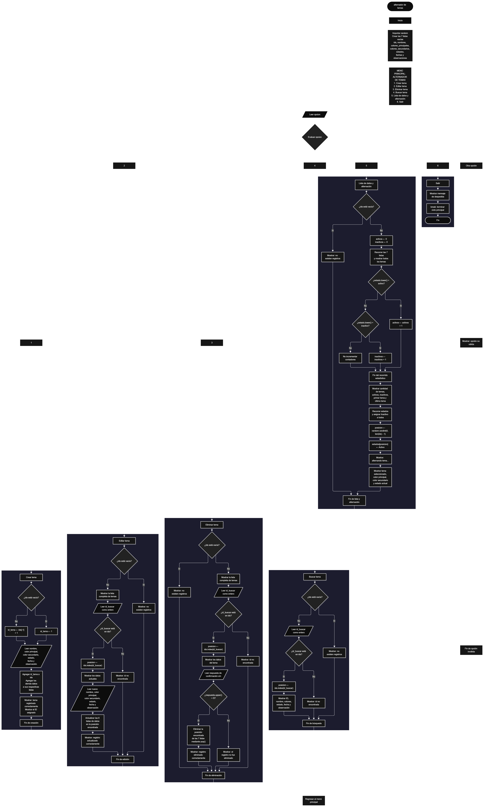

 

Este proyecto, llamado <b>alternador de temas</b>, fue desarrollado en <b>python</b> como un ejercicio práctico para fortalecer la lógica de programación mediante la creación de un sistema de gestión y selección aleatoria de temas desde la consola. El programa cuenta con un menú principal de seis opciones que permite <b>crear, editar, eliminar, buscar y listar temas</b>, además de consultar sus estadísticas y seleccionar aleatoriamente un tema para activarlo. Cada tema almacena información como el nombre, el color principal, el color secundario, el estado, la fecha de creación y una observación, utilizando siete listas paralelas que conservan los datos relacionados mediante sus posiciones. Durante su desarrollo se aplicaron conceptos fundamentales de programación, como variables, listas, estructuras condicionales, ciclos repetitivos, métodos de listas, funciones integradas y el módulo <b>random</b>. Este proyecto permite poner en práctica los conocimientos adquiridos en python y sirve como base para desarrollar sistemas de gestión y selección de temas más avanzados.

<h2 align="center">⚙️ Funcionamiento del menú principal</h2>

### ➕ Crear tema

La opción <b>1) crear tema</b> permite registrar un nuevo tema en el sistema. Antes de realizar el registro, el programa comprueba si la lista <b>ids</b> está vacía mediante la condición <b>len(ids) == 0</b>. Si no existen registros, asigna el identificador inicial <b>1</b> a la variable <b>id_tema</b>. En caso contrario, genera el siguiente identificador sumando uno al último valor almacenado mediante la expresión <b>ids[-1] + 1</b>. Después, solicita el <b>nombre, color principal, color secundario, estado, fecha de creación y observación</b> del tema. Los datos se almacenan en sus respectivas listas utilizando el método <b>append()</b>, manteniendo la misma posición para cada registro. Finalmente, muestra el mensaje <b>"tema registrado correctamente."</b> y presenta el identificador asignado. Esta operación permite incorporar nuevos temas para utilizarlos posteriormente en el proceso de alternación.

### ✏️ Editar tema

La opción <b>2) editar tema</b> permite modificar la información de un tema registrado. Primero, el programa comprueba si existen registros mediante la condición <b>len(ids) == 0</b>. Si no hay temas almacenados, muestra el mensaje <b>"no existen registros."</b>. En caso contrario, utiliza un ciclo <b>for</b> para mostrar los datos de todos los temas disponibles, incluyendo su identificador, nombre, colores, estado, fecha y observación. Después, solicita el identificador del registro que se desea editar y lo convierte a un número entero mediante <b>int(input())</b>. Si el identificador se encuentra en la lista <b>ids</b>, utiliza el método <b>index()</b> para obtener la posición correspondiente. A continuación, muestra los datos actuales y solicita la nueva información del tema, actualizando las listas <b>nombres, colores_principales, colores_secundarios, estados, fechas y observaciones</b>. El identificador original permanece sin cambios. Finalmente, presenta el mensaje <b>"registro actualizado correctamente."</b>. Si el identificador no existe, muestra el mensaje <b>"id no encontrada."</b>.

### 🗑️ Eliminar tema

La opción <b>3) eliminar tema</b> permite eliminar un tema registrado mediante su identificador. Antes de comenzar, el programa comprueba si existen registros. Si las listas están vacías, muestra el mensaje <b>"no existen registros."</b>. Si hay temas disponibles, presenta una lista con la información de cada uno y solicita el identificador del registro que se desea eliminar. Después, comprueba si el identificador está presente en <b>ids</b> y, si lo encuentra, utiliza <b>index()</b> para determinar su posición. El programa muestra los datos del tema seleccionado y solicita confirmación mediante la pregunta <b>"¿desea eliminar este registro? (s/n):"</b>. La condición <b>respuesta.upper() == "S"</b> permite confirmar la eliminación introduciendo <b>s</b> o <b>S</b>. Si se confirma, utiliza el método <b>pop()</b> para eliminar la posición correspondiente de las siete listas, conservando la relación entre los datos restantes. Finalmente, muestra el mensaje <b>"registro eliminado correctamente."</b>. Si no se confirma, presenta <b>"el registro no fue eliminado."</b>. Si el identificador no existe, informa que no fue encontrado.

### 🔎 Buscar tema

La opción <b>4) buscar tema</b> permite localizar un tema mediante su identificador. Primero, el programa comprueba si existen registros almacenados. Si no hay temas, muestra el mensaje <b>"no existen registros."</b>. En caso contrario, solicita el identificador mediante <b>int(input())</b> y comprueba si se encuentra en la lista <b>ids</b>. Cuando existe una coincidencia, utiliza <b>ids.index(id_buscar)</b> para obtener la posición del tema y mostrar todos sus datos: identificador, nombre, color principal, color secundario, estado, fecha y observación. Si el identificador no está registrado, presenta el mensaje <b>"id no encontrada."</b>. Esta función permite consultar un registro específico sin necesidad de mostrar toda la lista de temas.

### 📋 Lista de datos y alternación

La opción <b>5) lista de datos</b> permite visualizar los temas registrados, consultar sus estadísticas y seleccionar aleatoriamente uno para activarlo. Primero, el programa comprueba si existen registros. Si las listas están vacías, muestra el mensaje <b>"no existen registros."</b>. Si hay temas disponibles, inicializa las variables <b>activos</b> e <b>inactivos</b> en cero y utiliza un ciclo <b>for</b> para recorrer las listas y mostrar los datos de cada tema. Durante este recorrido, comprueba el estado almacenado en <b>estados</b> mediante el método <b>lower()</b>. Si el estado coincide con <b>"activo"</b>, aumenta el contador <b>activos</b>; si coincide con <b>"inactivo"</b>, aumenta <b>inactivos</b>. Después, muestra las estadísticas con la cantidad total de temas, los temas activos e inactivos, el primer tema registrado mediante <b>nombres[0]</b> y el último mediante <b>nombres[-1]</b>. Es importante señalar que estas estadísticas se calculan antes de realizar la nueva alternación. Posteriormente, utiliza un ciclo <b>for</b> para asignar el estado <b>"Inactivo"</b> a todos los temas. A continuación, selecciona una posición aleatoria mediante <b>random.randint(0, len(ids) - 1)</b> y asigna el estado <b>"Activo"</b> al tema seleccionado. Finalmente, muestra el nombre del tema elegido, su color principal, su color secundario y su estado actual. De esta manera, cada ejecución de esta opción deja exactamente un tema activo cuando existen registros.

### 🚪 Salir del menú principal

La opción <b>6) salir</b> permite finalizar la ejecución del programa. Cuando el usuario selecciona esta opción, el programa muestra el mensaje <b>"gracias por utilizar el alternador de temas."</b> y ejecuta la instrucción <b>break</b>, que interrumpe el ciclo <b>while True</b> y termina el menú principal. Si el usuario introduce un valor diferente de las opciones disponibles, se ejecuta el bloque <b>else</b> y se presenta el mensaje <b>"opción no válida."</b>. De esta forma, el programa mantiene el menú en funcionamiento mientras el usuario realiza las operaciones disponibles y finaliza cuando selecciona la opción correspondiente.

<h2 align="center">🧠 Temas aplicados en el proyecto</h2>

### 📦 Variables

En este proyecto se utilizan variables para controlar la opción seleccionada en el menú, almacenar temporalmente los datos introducidos, identificar la posición de un tema y calcular las estadísticas de los registros. Cada variable cumple una función específica dentro de las operaciones de gestión y alternación.

🔢 **Opcion:** Almacena la opción seleccionada por el usuario en el menú principal.

🆔 **Id_tema:** Almacena el identificador asignado al nuevo tema durante el registro.

🔎 **Id_buscar:** Guarda el identificador introducido por el usuario para localizar un tema.

📍 **Posicion:** Almacena la posición del tema encontrado o seleccionado dentro de las listas.

📝 **Nombre:** Almacena temporalmente el nombre del tema que se va a registrar.

🎨 **Color_principal:** Almacena el color principal introducido durante el registro.

🎨 **Color_secundario:** Almacena el color secundario introducido durante el registro.

📊 **Activos:** Cuenta los temas cuyo estado coincide con <b>"activo"</b> durante el recorrido de las estadísticas.

📊 **Inactivos:** Cuenta los temas cuyo estado coincide con <b>"inactivo"</b> durante el recorrido de las estadísticas.

🔄 **I:** Funciona como contador en los ciclos <b>for</b> utilizados para recorrer las listas.

🗑️ **Respuesta:** Almacena la respuesta del usuario para confirmar o cancelar la eliminación de un tema.

🎲 **Random:** Es el módulo importado para seleccionar aleatoriamente la posición de un tema.

### 🗃️ Listas

En este proyecto se utilizan siete listas paralelas para almacenar los datos de los temas registrados. Todas las listas mantienen la misma organización por posiciones, de modo que cada índice representa un mismo tema en todas ellas. Por ejemplo, la información de un tema ubicado en la posición <b>0</b> se encuentra distribuida entre <b>ids[0], nombres[0], colores_principales[0], colores_secundarios[0], estados[0], fechas[0]</b> y <b>observaciones[0]</b>. Esta estructura permite recorrer, buscar, editar, eliminar y mostrar los registros conservando la correspondencia entre sus datos.

🆔 **Ids:** Almacena los identificadores de los temas registrados.

📝 **Nombres:** Almacena los nombres de los temas.

🎨 **Colores_principales:** Almacena los colores principales de los temas.

🎨 **Colores_secundarios:** Almacena los colores secundarios de los temas.

🔘 **Estados:** Almacena el estado de cada tema, utilizado para determinar cuál está activo o inactivo.

📅 **Fechas:** Almacena las fechas de creación de los temas.

📄 **Observaciones:** Almacena las observaciones asociadas a cada tema.

### 🔀 Estructuras condicionales

En este proyecto se utilizan las estructuras <b>if, elif y else</b> para controlar las opciones del menú principal y decidir qué operación debe ejecutarse. También permiten comprobar si existen registros antes de realizar una operación, determinar si un identificador está almacenado, confirmar la eliminación de un tema y contar los registros según su estado. Estas condiciones permiten que el programa responda de forma diferente dependiendo de los datos disponibles y de las decisiones del usuario.

### 🔄 Estructuras repetitivas

El programa utiliza los ciclos <b>while True</b> y <b>for</b>. El ciclo <b>while True</b> mantiene el menú principal en ejecución hasta que el usuario selecciona la opción de salida y se ejecuta <b>break</b>. Los ciclos <b>for</b> permiten recorrer las listas para mostrar los registros, contar los estados y asignar el estado <b>"Inactivo"</b> a todos los temas antes de realizar una nueva selección aleatoria.

### 🧰 Métodos de listas y cadenas

El programa utiliza distintos métodos para administrar los registros y procesar las entradas. El método <b>append()</b> agrega los datos de un nuevo tema al final de cada lista, mientras que <b>pop()</b> elimina los datos de una posición determinada. El método <b>index()</b> permite encontrar la posición asociada a un identificador, <b>upper()</b> convierte la respuesta de confirmación a mayúsculas y <b>lower()</b> convierte los estados a minúsculas para compararlos sin distinguir entre mayúsculas y minúsculas.

### 🔢 Funciones integradas

En el proyecto se utilizan funciones integradas de python para controlar las listas y procesar las entradas. La función <b>len()</b> permite conocer la cantidad de registros almacenados y determinar los límites de la selección aleatoria. La función <b>int()</b> convierte el identificador introducido por el usuario en un número entero. La función <b>input()</b> solicita información durante la ejecución, mientras que <b>print()</b> muestra los mensajes, los datos de los temas y las estadísticas. Estas funciones facilitan la interacción entre el usuario y el programa.

### 🎲 Selección aleatoria con random

El programa importa el módulo <b>random</b> mediante la instrucción <b>import random</b>. En la opción de alternación, utiliza la función <b>random.randint(0, len(ids) - 1)</b> para generar un número entero aleatorio entre la primera posición válida y la última posición ocupada por un tema. El resultado se almacena en la variable <b>posicion</b>, que se utiliza para identificar el tema que será activado. Como el programa comprueba previamente que existan registros, el rango de selección contiene al menos una posición válida.

### 🔄 Actualización de estados

La actualización de los estados es el procedimiento que permite alternar entre los temas registrados. Primero, el programa recorre la lista <b>estados</b> y asigna <b>"Inactivo"</b> a todas las posiciones. Después, obtiene una posición aleatoria y asigna <b>"Activo"</b> al tema correspondiente. Esta operación modifica directamente la información almacenada en las listas, por lo que el nuevo estado se conserva durante la ejecución y puede consultarse en las siguientes operaciones.

<h2 align="center">¿Cómo se implementaron las operaciones crud en el proyecto?</h2>

Las operaciones <b>crud</b> se implementaron mediante las opciones del menú principal, permitiendo administrar los temas registrados. La operación <b>crear</b> corresponde a <b>crear tema</b>, donde se solicitan los datos y se agregan a las listas mediante <b>append()</b>. La operación <b>leer</b> se realiza mediante las opciones <b>buscar tema</b> y <b>lista de datos</b>, que permiten consultar un registro o visualizar todos los temas y sus estadísticas. La operación <b>actualizar</b> corresponde a <b>editar tema</b>, donde se modifican los datos del tema seleccionado sin cambiar su identificador. Finalmente, la operación <b>eliminar</b> corresponde a <b>eliminar tema</b>, donde se confirma la acción y se eliminan los datos de la posición correspondiente mediante <b>pop()</b>. Estas operaciones utilizan listas paralelas, variables, condicionales y ciclos para administrar la información temporalmente durante la ejecución del programa.

<h2 align="center">Diagrama de flujo del proyecto</h2>

El diagrama de flujo representa la estructura general del programa, comenzando con la inicialización de las listas y la presentación del menú principal. A continuación, muestra las seis opciones disponibles y los procesos correspondientes a la creación, edición, eliminación, búsqueda, listado y alternación de temas. También representa las comprobaciones de registros, la búsqueda mediante identificadores, la confirmación de eliminación y el proceso de selección aleatoria que desactiva todos los temas y activa uno de ellos. Finalmente, muestra la salida del menú y la finalización del programa.

<h2 align="center">🛡️ Validaciones del programa</h2>

### 📭 No existen registros

Esta comprobación se utiliza en las opciones de <b>editar, eliminar, buscar y lista de datos</b>. El programa verifica si la lista <b>ids</b> está vacía mediante la condición <b>len(ids) == 0</b>. Si no existen temas registrados, muestra el mensaje <b>"no existen registros."</b> y evita ejecutar el resto de la operación. Esta comprobación también impide que la opción de alternación intente seleccionar un tema cuando no hay registros disponibles.

### 🔎 Identificador no encontrado

Esta comprobación se utiliza durante las operaciones de <b>editar, eliminar y buscar tema</b>. El programa verifica si el identificador introducido está presente en la lista <b>ids</b>. Si encuentra una coincidencia, obtiene su posición mediante <b>index()</b> y continúa con la operación correspondiente. Si no existe, muestra el mensaje <b>"id no encontrada."</b>, evitando modificar, eliminar o mostrar un registro que no se encuentra almacenado.

### ⚠️ Confirmación de eliminación

Antes de eliminar un tema, el programa muestra sus datos y solicita una confirmación al usuario. La condición <b>respuesta.upper() == "S"</b> comprueba si la respuesta es la letra <b>s</b>, independientemente de si se introduce en mayúscula o minúscula. Si se confirma, elimina los datos de las siete listas mediante <b>pop()</b>. En caso contrario, muestra el mensaje <b>"el registro no fue eliminado."</b> y conserva el tema registrado.

### 🔢 Conversión del identificador

Durante las operaciones de edición, eliminación y búsqueda, el programa utiliza <b>int(input())</b> para convertir el identificador introducido por el usuario en un número entero. Sin embargo, el código actual no comprueba si la entrada contiene un valor numérico válido. Si se introduce texto que no pueda convertirse en entero, python puede generar un error y detener la ejecución del programa.

### 🔘 Estados de los temas

Durante el cálculo de las estadísticas, el programa compara los estados utilizando <b>lower()</b>, por lo que reconoce valores como <b>"Activo"</b>, <b>"ACTIVO"</b> y <b>"activo"</b> como equivalentes. Sin embargo, al crear o editar un tema, no se comprueba que el estado introducido corresponda únicamente a <b>"activo"</b> o <b>"inactivo"</b>. Por ello, los valores diferentes de esas dos opciones no se incluyen en los contadores de las estadísticas. Cuando se ejecuta la alternación, todos los estados se reemplazan por <b>"Inactivo"</b> y el tema seleccionado pasa a <b>"Activo"</b>.

### 🆔 Generación de identificadores

Durante la creación de un tema, el programa genera el identificador a partir del último valor almacenado en <b>ids</b>, utilizando la expresión <b>ids[-1] + 1</b>. Esta estrategia permite generar identificadores consecutivos mientras se mantenga el orden habitual de los registros. Sin embargo, si se elimina el último tema y posteriormente se crea otro, el programa puede reutilizar un identificador que ya se había utilizado anteriormente, porque no conserva un contador independiente de identificadores.

### ⚠️ Opción inválida

El bloque <b>else</b> del menú principal muestra el mensaje <b>"opción no válida."</b> cuando el usuario introduce un valor diferente de las opciones disponibles. Esta comprobación permite informar al usuario de que debe seleccionar una de las seis opciones definidas. No obstante, la entrada del menú no se valida mediante una conversión numérica, ya que las opciones se comparan directamente como cadenas de texto.

### 💾 Almacenamiento temporal

Los registros se almacenan en las listas creadas al inicio del programa. El código actual no utiliza archivos, bases de datos ni mecanismos de persistencia, por lo que los temas registrados y los estados actualizados se conservan únicamente mientras la aplicación permanece en ejecución. Cuando el programa finaliza, la información almacenada en memoria deja de estar disponible para una ejecución posterior.

<h2 align="center">🎯 Objetivo del proyecto</h2>

El objetivo principal de este proyecto es fortalecer la <b>lógica de programación</b> mediante el desarrollo de un sistema de gestión y selección aleatoria de temas en <b>python</b>. A través de su construcción se busca aplicar conocimientos sobre variables, listas, estructuras condicionales, ciclos repetitivos, métodos de listas y funciones integradas, integrándolos en un programa que permite registrar, consultar, modificar y eliminar información. Además, el proyecto permite comprender cómo utilizar el módulo <b>random</b> para seleccionar un tema de manera aleatoria y actualizar los estados de los registros, estableciendo una base para desarrollar aplicaciones más completas e interactivas.

